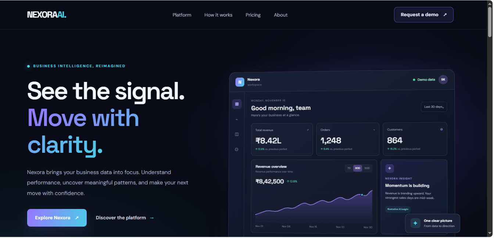
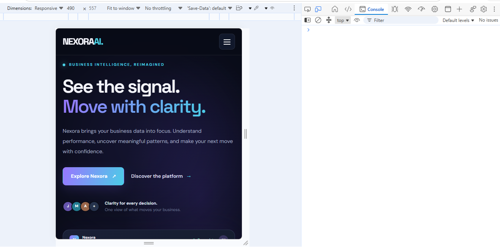

# Nexora AI — SaaS Landing Page

A responsive, front-end-only SaaS landing page concept for **Nexora AI**, a fictional business intelligence platform. Built for the Sankar Group Front-End Development Internship assignment using HTML, CSS and vanilla JavaScript.

## Live demo

[Visit Nexora AI](https://simran-dev341.github.io/nexora.ai/)

## Features

- Responsive layout for desktop, tablet and mobile.
- Sticky navigation with accessible mobile menu.
- Hero section with an illustrative analytics dashboard.
- Interactive 7D / 30D / 90D chart preview.
- Feature cards, how-it-works section, pricing and about sections.
- Pricing buttons preselect the corresponding demo-form plan.
- Contact form with browser validation and an on-page confirmation state.
- Scroll-reveal animations using `IntersectionObserver`.
- Reduced-motion support and keyboard focus styles.
- SEO description, Open Graph metadata and custom SVG favicon.
- No framework, build step, database or API key required.

## Tech stack

- HTML5
- CSS3 (Grid, Flexbox, custom properties, media queries and animations)
- Vanilla JavaScript (DOM events, `IntersectionObserver`, `FormData`)
- Google Fonts: DM Sans and Space Grotesk (system fallbacks are included)

## Run locally

1. Download or clone this repository.
2. Open the project folder in Visual Studio Code.
3. Open `index.html` in a browser, or use the VS Code **Live Server** extension.
4. No package installation or build command is needed.

## Project structure

```text
nexora-ai/
├── index.html
├── style.css
├── script.js
├── README.md
├── .gitignore
├── assets/
│   └── favicon.svg
└── screenshots/
    └── (add your real desktop and mobile screenshots here)
```

## Interaction notes

- The chart period controls change the illustrative chart line and displayed sample value.
- The mobile navigation opens, closes on link selection, and supports the Escape key.
- Pricing calls to action scroll to the form and select the chosen plan.
- The contact form validates required fields and displays an on-page confirmation.
- **The form is a front-end demonstration only. It does not transmit, store or email submitted information.**
- Dashboard figures, business insights and prices are fictional sample content for this concept project. They are not live analytics or commercial offers.

## Deployment

### GitHub Pages

1. Create a new GitHub repository, for example `nexora-ai`.
2. Upload all project files and folders to the repository root.
3. Open **Settings → Pages**.
4. Under **Build and deployment**, choose **Deploy from a branch**.
5. Select the `main` branch and `/ (root)` folder, then save.
6. Wait for the deployment workflow to finish. Your site URL will appear in the Pages section.

### Netlify

1. Sign in to Netlify and choose **Add new site → Import an existing project**.
2. Connect your GitHub account and select the `nexora-ai` repository.
3. Leave the build command blank and set the publish directory to `/` (repository root).
4. Deploy the site. Netlify will provide a public URL.

## Submission checklist

- [ ] Confirm all navigation links and CTA buttons.
- [ ] Test the chart period buttons (7D, 30D, 90D).
- [ ] Test the contact form with empty and valid values.
- [ ] Test mobile navigation and close it with Escape.
- [ ] Inspect the page at desktop, tablet and mobile widths.
- [ ] Capture a full desktop screenshot and a mobile screenshot from the browser.
- [ ] Add the screenshots to the `screenshots/` folder and link them below.
- [ ] Deploy the site and replace the live demo placeholder above.
- [ ] Push the final source code to GitHub.

## Screenshots

## Screenshots

### Desktop view


### Mobile view


## Design explanation

Nexora AI uses a dark navy foundation with violet and cyan accents to create a focused technology aesthetic. The hero dashboard gives visitors an immediate product preview, while the light feature and pricing sections create visual contrast and improve scanning. CSS Grid and Flexbox organize the layouts, and media queries adapt the navigation, cards, dashboard and form for smaller screens. JavaScript provides mobile navigation, scroll-reveal effects, interactive chart periods, pricing-plan selection and client-side form validation.

## Project status

This is a portfolio / internship assignment concept. It is not a production analytics service. No backend, authentication, payments or real AI model integration is included because those are outside the assignment scope.
